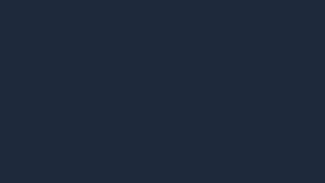
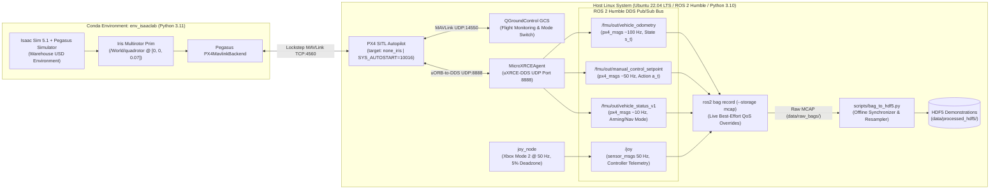

# End-to-End Aerial Robotics Teleoperation & Imitation Learning Data Capture Pipeline

[](https://releases.ubuntu.com/22.04/)
[](https://developer.nvidia.com/isaac-sim)
[](https://pegasussimulator.github.io/PegasusSimulator/)
[](https://px4.io/)
[](https://docs.ros.org/en/humble/)
[](https://mcap.dev/)

An industrial-grade simulation, teleoperation, and imitation learning data capture pipeline bridging **NVIDIA Isaac Sim 5.1** physics, **Pegasus Simulator v5.1.0**, **PX4 SITL**, and **ROS 2 Humble**. 

This repository enables human operators to fly complex multirotor trajectories in photorealistic, physically accurate warehouse environments using standard game controllers, streaming time-synchronized microsecond-aligned state observations \(s_t\) and normalized control actions \(a_t\) directly into **MCAP** ROS 2 bags and **HDF5** datasets formatted for Behavioral Cloning, Action Chunking with Transformers (ACT), and Diffusion Policy architectures.

---

## Visual Preview

| Isaac Sim Warehouse Scene & QGroundControl SITL | Synchronized ROS 2 Telemetry & Topic Streaming |
| :---: | :---: |
|  |  |
| *NVIDIA Isaac Sim 5.1 + Pegasus Iris Quadrotor in Warehouse USD* | *Live microsecond uXRCE-DDS State Observations and Action Setpoints* |

---

## System Architecture

The pipeline enforces strict **runtime process isolation** between Isaac Sim's bundled Python 3.11 environment and the host Ubuntu ROS 2 Humble Python 3.10 middleware stack. Inter-process communication operates via low-latency lockstep MAVLink TCP (`4560`) and high-throughput uXRCE-DDS UDP (`8888`).



---

## Repository Structure

```text
isaac-sim-px4-imitation-capture/
├── configs/
│   ├── sim_config.yaml          # Master simulation, networking, and topic parameters
│   └── xbox_joy_mapping.yaml    # Hardware-verified Mode 2 Xbox controller mapping
├── data/
│   ├── processed_hdf5/          # Resampled, time-aligned imitation learning datasets
│   └── raw_bags/                # Timestamped raw ROS 2 MCAP bags with QoS metadata
├── docs/
│   └── images/
│       ├── ros2_topics_telemetry.png   # Placeholder: RQT / terminal telemetry stream
│       └── sim_warehouse_qgc.png       # Placeholder: Isaac Sim + QGC dual-viewport capture
├── scripts/
│   ├── bag_to_hdf5.py           # Offline MCAP-to-HDF5 resampler and episode segmenter
│   ├── pegasusLaunch.py         # Standalone Isaac Sim 5.1 + Pegasus simulation launcher
│   ├── record_episode.sh        # Live MCAP episode recorder with QoS profile overrides
│   └── run_sim_capture.sh       # Multi-process orchestrator (Isaac Sim, QGC, DDS, joy)
└── README.md                    # Project documentation and engineering manual
```

---

## Key Engineering Decisions

### 1. uXRCE-DDS (`MicroXRCEAgent`) vs. MAVROS
Traditional aerial robotics pipelines use MAVROS over serial or UDP MAVLink streams. For high-frequency imitation learning, this introduces two major bottlenecks: serialization overhead of MAVLink packet wrapping and time jitter caused by asynchronous packet parsing. 

In this stack, PX4's native **uXRCE-DDS client** communicates directly with **`MicroXRCEAgent`** over UDP port `8888`. This achieves:
- **Direct uORB-to-DDS Translation:** uORB internal message structures map 1:1 to ROS 2 `px4_msgs` without intermediary message transcoding.
- **Sub-Millisecond Latency:** Bypasses MAVLink stream serialization, achieving deterministic transport latency (<1 ms).
- **Single-Clock Microsecond Synchronization:** Telemetry timestamps originate directly from the PX4 internal monotonic clock (`timestamp_sample` in microseconds), guaranteeing zero clock-drift skew between state observations \(s_t\) and actions \(a_t\).

### 2. Conda (Python 3.11) Subshell Isolation vs. Host ROS 2 (Python 3.10)
NVIDIA Isaac Sim 5.1 runs on Python 3.11 with custom compiled C++ binaries, glibc hooks, and CUDA runtimes. Sourcing ROS 2 Humble (built against Python 3.10) inside the same environment causes immediate ABI collisions, corrupting `rclpy`, `pybind11`, and FastDDS dynamic shared libraries (`libfastrtps.so`).

[`scripts/run_sim_capture.sh`](file:///home/haipy/Desktop/isaac-sim-px4-imitation-capture/scripts/run_sim_capture.sh) enforces an explicit subshell barrier:
```bash
(
    eval "$(conda shell.bash hook)"
    conda activate env_isaaclab
    python "$ISAAC_SCRIPT"
) &
```
The Isaac Sim physics and rendering processes execute in isolation, while the host shell maintains clean environment variables (`PYTHONPATH`, `LD_LIBRARY_PATH`, and ROS 2 middleware bindings).

### 3. Live MCAP Recording with Offline HDF5 Conversion
Streaming live demonstration data directly into compressed HDF5 files during flight introduces filesystem I/O locks and unpredictable garbage-collection pauses into the simulation loop. 

Instead, the pipeline separates data collection into two deterministic phases:
1. **Live High-Throughput Ingestion:** [`scripts/record_episode.sh`](file:///home/haipy/Desktop/isaac-sim-px4-imitation-capture/scripts/record_episode.sh) captures serialized CDR buffers directly to disk using the **MCAP** storage plugin (`ros2 bag record --storage mcap`). MCAP provides zero-copy appending, self-contained message definitions, and chunked indexing.
2. **Offline Resampling & Segmentation:** [`scripts/bag_to_hdf5.py`](file:///home/haipy/Desktop/isaac-sim-px4-imitation-capture/scripts/bag_to_hdf5.py) executes offline to linearly interpolate odometry (\(\sim 100\text{ Hz}\)) and actions (\(\sim 50\text{ Hz}\)) to a uniform \(50\text{ Hz}\) clock, segments active flight boundaries, and compresses trajectories into standardized HDF5 files for ACT / Diffusion Policy training.

---

## Prerequisites & Setup

### 1. Host System Requirements
- **OS:** Ubuntu 22.04 LTS (Jammy Jellyfish)
- **GPU:** NVIDIA RTX 3080 / A4000 or higher (8GB+ VRAM, NVIDIA Driver $\ge 535$)
- **ROS 2:** ROS 2 Humble Desktop (`ros-humble-desktop`, `ros-humble-joy`, `ros-humble-rosbag2-storage-mcap`)

### 2. Software Installation Paths
Ensure the following components are installed at their verified paths or updated in [`configs/sim_config.yaml`](file:///home/haipy/Desktop/isaac-sim-px4-imitation-capture/configs/sim_config.yaml):

1. **NVIDIA Isaac Sim 5.1 + Pegasus Simulator v5.1.0:**
   Installed inside Conda environment `env_isaaclab` (Python 3.11):
   ```bash
   conda activate env_isaaclab
   pip install isaacsim-rl isaacsim-replicator pegasus-simulator
   ```
2. **PX4-Autopilot SITL:**
   Cloned and compiled at `/home/haipy/PX4-Autopilot`:
   ```bash
   git clone --recursive https://github.com/PX4/PX4-Autopilot.git /home/haipy/PX4-Autopilot
   cd /home/haipy/PX4-Autopilot
   DONT_RUN=1 make px4_sitl none_iris
   ```
3. **MicroXRCEAgent:**
   Installed system-wide:
   ```bash
   git clone https://github.com/eProsima/Micro-XRCE-DDS-Agent.git /tmp/uxrce
   cd /tmp/uxrce && mkdir build && cd build
   cmake .. && make -j$(nproc) && sudo make install
   sudo ldconfig
   ```
4. **ROS 2 `px4_msgs` Workspace:**
   Built at `/home/haipy/ros2_px4_ws`:
   ```bash
   mkdir -p /home/haipy/ros2_px4_ws/src
   cd /home/haipy/ros2_px4_ws/src
   git clone https://github.com/PX4/px4_msgs.git -b release/1.14
   cd /home/haipy/ros2_px4_ws
   source /opt/ros/humble/setup.bash
   colcon build --symlink-install
   ```
5. **QGroundControl:**
   Executable AppImage located at:
   `/home/haipy/Desktop/PEGASUS_ISAACSIM/QGroundControl-x86_64.AppImage`

---

## Flight Teleoperation Mapping (Mode 2)

As specified in [`configs/xbox_joy_mapping.yaml`](file:///home/haipy/Desktop/isaac-sim-px4-imitation-capture/configs/xbox_joy_mapping.yaml), teleoperation follows standard aviation **Mode 2** RC stick layout:

| Axis / Button | Index | Controller Physical Input | Flight Axis / Action | Polarity & Range |
| :--- | :---: | :--- | :--- | :--- |
| `axes[0]` | 0 | Left Stick Horizontal | **Yaw Rate (\(r\))** | `+1.0` (CCW / Left), `-1.0` (CW / Right) |
| `axes[1]` | 1 | Left Stick Vertical | **Throttle / Collective (\(T\))** | `+1.0` (Climb / Up), `-1.0` (Descend / Down) |
| `axes[3]` | 3 | Right Stick Horizontal | **Roll Angle (\(\phi\))** | `+1.0` (Roll Left), `-1.0` (Roll Right) |
| `axes[4]` | 4 | Right Stick Vertical | **Pitch Angle (\(\theta\))** | `+1.0` (Pitch Forward / Nose Down), `-1.0` (Pitch Backward) |
| `buttons[6]` | 6 | Back / View Button | **Arm / Disarm Toggle** | Discrete Toggle (`1` = Toggle Arming State) |

> [!NOTE]
> `joy_node` applies a hardware deadzone of `0.05` (5%) and publishes continuously at `50.0 Hz` (`autorepeat_rate:=50.0`) to avoid telemetry dropouts when sticks rest centered.

---

## Quickstart & Data Collection Workflow

### Step 1: Launch the Master Simulation & Teleoperation Stack
Execute the master orchestration script:
```bash
./scripts/run_sim_capture.sh
```
This automatically initializes the full stack in dependency order:
1. Spawns Isaac Sim 5.1 inside `env_isaaclab` and loads the Pegasus `Warehouse` stage.
2. Spawns the `Iris` quadrotor at `[0.0, 0.0, 0.07]` and binds the PX4 MAVLink SITL backend (`TCP 4560`).
3. Launches QGroundControl (`QGroundControl-x86_64.AppImage`) for flight mode oversight.
4. Initializes `MicroXRCEAgent` on UDP port `8888`.
5. Starts `joy_node` at 50 Hz with 5% deadzone filtering.

### Step 2: Record Demonstration Episodes
In a separate terminal, trigger episode recording before commencing the flight maneuver:
```bash
# Auto-stamped: data/raw_bags/ep_<TIMESTAMP>_warehouse_flight/
./scripts/record_episode.sh

# Or supply a descriptive flight tag:
./scripts/record_episode.sh obstacle_slalom_01
```

1. **Arm the drone:** Press `buttons[6]` (Back/View button) or arm via QGroundControl.
2. **Fly demonstration:** Perform the desired trajectory (e.g., waypoint tracking, obstacle slalom, warehouse aisle navigation).
3. **Disarm & Finalize:** Land, toggle disarm, and press `Ctrl+C` in the recording terminal. The MCAP bag is cleanly closed and indexed.

### Step 3: Convert MCAP Bags to HDF5 Demonstrations
Resample and convert raw MCAP bags into training-ready HDF5 datasets:
```bash
# Convert all raw bags in data/raw_bags/ to data/processed_hdf5/
python3 scripts/bag_to_hdf5.py

# Or convert a specific episode at 50 Hz:
python3 scripts/bag_to_hdf5.py --bag_path data/raw_bags/ep_20261118_203000_obstacle_slalom_01 --target_hz 50.0
```

#### Exported HDF5 Dataset Layout:
```text
dataset.h5
├── observations/
│   ├── position             # [N, 3] (x, y, z) local position in meters
│   ├── orientation_wxyz     # [N, 4] (w, x, y, z) normalized quaternion
│   ├── linear_velocity      # [N, 3] (vx, vy, vz) linear velocity in m/s
│   └── angular_velocity     # [N, 3] (wx, wy, wz) body rates in rad/s
├── actions/
│   ├── manual_control       # [N, 4] (roll, pitch, yaw, throttle) in [-1, 1]
│   ├── joy_axes             # [N, 8] raw controller analog axes
│   └── joy_buttons          # [N, 11] raw controller discrete buttons
├── flight_status/
│   └── arming_state         # [N] PX4 arming state (2 = ARMING_STATE_ARMED)
├── timestamps               # [N] float64 synchronized episode time (seconds)
└── timestamps_ns            # [N] int64 POSIX nanosecond timestamp
```

---

## Troubleshooting & Known Pitfalls

### 1. `PX4 server already running for instance 0`
- **Cause:** A previous PX4 SITL process crashed or was terminated without freeing the POSIX shared memory locks (`/dev/shm/px4_*`) and TCP server port `4560`.
- **Fix:** Both [`scripts/run_sim_capture.sh`](file:///home/haipy/Desktop/isaac-sim-px4-imitation-capture/scripts/run_sim_capture.sh) and the exit trap run:
  ```bash
  pkill -9 -x px4
  rm -f /dev/shm/px4_* /tmp/px4_*
  ```

### 2. `Waiting for first heartbeat from simulator...`
- **Cause:** PX4 SITL started before Isaac Sim opened TCP port `4560`, or PX4 was launched with a vehicle target expecting Gazebo / Lockstep UDP rather than Pegasus MAVLink TCP.
- **Fix:**
  - Verify [`scripts/pegasusLaunch.py`](file:///home/haipy/Desktop/isaac-sim-px4-imitation-capture/scripts/pegasusLaunch.py) sets `px4_autolaunch: True` and airframe model to `self.pg.px4_default_airframe`.
  - Ensure the target airframe is built with `DONT_RUN=1 make px4_sitl none_iris`.

### 3. Silent Zero-Message ROS 2 Bag Recordings
- **Cause:** PX4 uXRCE-DDS topics publish under `RELIABILITY: BEST_EFFORT` and `DURABILITY: TRANSIENT_LOCAL`. Default `ros2 bag record` subscribers use `RELIABILITY: RELIABLE`. DDS drops incompatible QoS connections silently without warning.
- **Fix:** [`scripts/record_episode.sh`](file:///home/haipy/Desktop/isaac-sim-px4-imitation-capture/scripts/record_episode.sh) automatically passes `--qos-profile-overrides-path /tmp/px4_bag_qos.yaml` containing:
  ```yaml
  /fmu/out/vehicle_odometry:
    reliability: best_effort
    durability: transient_local
    history: keep_last
    depth: 10
  ```

### 4. Conda Python 3.11 vs. ROS 2 Humble Python 3.10 ABI Conflicts
- **Cause:** Attempting to `source /opt/ros/humble/setup.bash` after activating Conda `env_isaaclab` results in `ImportError: /usr/lib/x86_64-linux-gnu/libstdc++.so.6: version 'GLIBCXX_3.4.30' not found` or symbol mismatch in `rclpy._rclpy_pybind11`.
- **Fix:** Never source ROS 2 inside the Conda environment. Always keep Isaac Sim in an isolated subshell as structured in `run_sim_capture.sh`.

---

## License & Citation
This pipeline is distributed under the MIT License. If used in academic research or technical benchmarking for Imitation Learning / Robotics Manipulation & Flight, please reference this repository.
